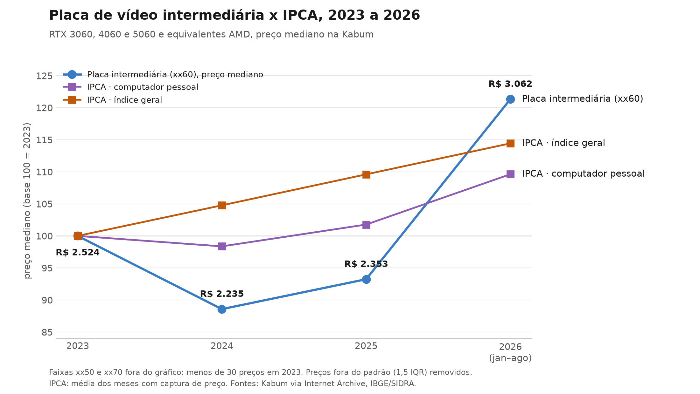

# O IPCA reflete o preço real pago por quem compra tecnologia?

Trabalho da disciplina de Mineração de Dados, feito por Davi Stefanoski, Enon Demori e
Leonardo Cherini.

O IPCA desconta a melhoria dos produtos de tecnologia. Se a placa nova rende mais pelo mesmo
dinheiro, parte do aumento não entra na conta da inflação. Só que na loja ninguém paga em
desempenho, paga o valor da etiqueta. Queríamos saber de quanto é essa distância.

API publicada: https://ipca-placas-de-video.onrender.com/docs

## O que encontramos

De 2023 a 2026 a placa intermediária (RTX 3060, 4060, 5060 e as equivalentes da AMD) passou de
R$ 2.524 para R$ 3.062, uma alta de 21,3%. O IPCA de computadores subiu 9,6% no mesmo intervalo,
e o IPCA geral, 14,4%.



Treinamos dois modelos em cima dessa base. Um tenta adivinhar o preço de um anúncio pelas
características da placa e erra R$ 932 em média. O outro faz o contrário: recebe preço, memória
e marca, não vê o nome do anúncio, e tenta dizer em que faixa a placa está. Acerta 93%.

Esse segundo foi o que rendeu mais. Se dá para reconstruir a faixa só pelo preço, a divisão que
usamos não é invenção nossa, tem lastro no mercado. E quando ele erra, costuma estar certo do
jeito dele: a GTX 1060, que no papel é intermediária, sai hoje a preço de entrada porque é de
uma geração que já acabou.

O resto dos números, as variantes de método e o que não funcionou estão no
[RELATORIO.md](RELATORIO.md).

## De onde vêm os dados

| Fonte | O que traz | Tamanho |
|---|---|---|
| Kabum, via Internet Archive | Histórico de preços da página de placas de vídeo | 2.160 preços, 84 capturas, 43 meses |
| Kabum, coleta diária | Preços correntes, desde 13/09/2026 | 26.884 preços, 62 dias |
| IBGE / SIDRA, tabela 7060 | IPCA geral e subitem "Computador pessoal" | 56 meses |
| Banco Central, SGS série 1 | Dólar PTAX diário | 1.182 cotações |

Passada a limpeza, sobram 3.406 anúncios com chip identificado, de 71 modelos diferentes.

## Estrutura

```
src/
  coleta_acervo.py     histórico de preços no Internet Archive
  retenta_acervo.py    repete as capturas que falharam
  coleta_diaria.py     preços do dia na Kabum
  coleta_oficial.py    IPCA e dólar
  hedonico.py          junta as fontes, extrai chip e faixa, regressão de verificação
  medianas.py          mediana por faixa comparada ao IPCA (método principal)
  exploracao.py        gráficos exploratórios
  modelo.py            modelos de preço e de faixa
  graficos.py          gráficos da regressão
  api.py               API de consulta
dados/                 bases coletadas e resultados
figuras/               gráficos
.github/workflows/     coleta diária e análise semanal
```

## Como rodar

```bash
pip install -r requirements.txt

python src/coleta_acervo.py     # histórico, leva uns 10 minutos
python src/retenta_acervo.py    # repete as capturas que falharam
python src/coleta_oficial.py    # IPCA e dólar
python src/hedonico.py          # atributos e regressão
python src/medianas.py          # método principal
python src/exploracao.py        # gráficos exploratórios
python src/modelo.py            # modelos de aprendizado de máquina
python src/graficos.py          # gráficos da regressão

uvicorn src.api:app --reload    # API em http://127.0.0.1:8000/docs
```

## Automação

A coleta roda quatro vezes por dia no GitHub Actions e guarda os preços do dia. Toda segunda a
análise inteira roda de novo e atualiza gráficos e resultados. As duas comitam aqui no
repositório, então a base cresce sem ninguém mexer. Para publicar a API, ver
[DEPLOY.md](DEPLOY.md).

## Limitações

Tudo vem de uma loja só, a Kabum, porque Terabyte e Pichau bloqueiam a coleta. Faltam capturas
de fevereiro a maio de 2023, e o dia 20/09/2026 ficou vazio por um bloqueio temporário. Só a
faixa intermediária tem anúncio suficiente em todos os anos. E o subitem do IPCA que usamos
cobre computadores inteiros, não placas de vídeo, então a comparação vale pela tendência, não
pelo valor exato.
