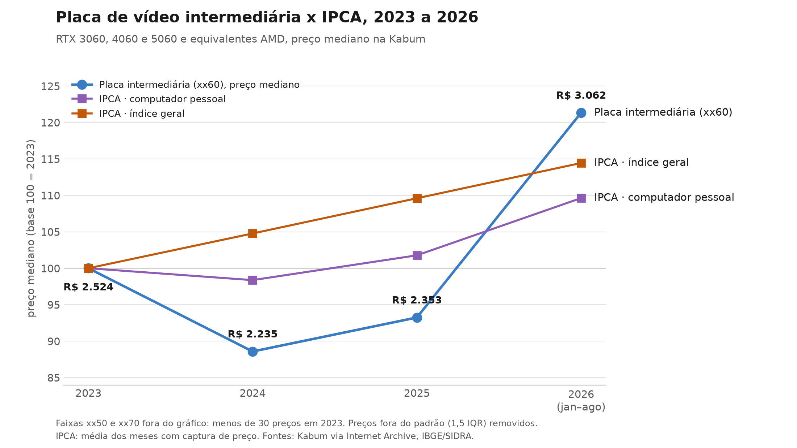

# O IPCA mede a inflação de quem compra tecnologia?

Relatório técnico do projeto. Placas de vídeo como caso de estudo, Kabum como fonte de preço,
IPCA e dólar como referência.

---

## Resultado em poucas linhas

- **De 2023 a 2026, o preço mediano da placa intermediária (xx60) subiu 21,3%**
  (R$ 2.524 → R$ 3.062). No mesmo período o IPCA de computadores subiu 9,6% e o IPCA geral 14,4%.
  A placa subiu **mais que o dobro do IPCA de computadores e acima da inflação geral**.
- **O preço não anda junto com o índice, anda em ciclo próprio.** De 2022 a 2024 a mediana da
  xx60 caiu 29,6% (R$ 3.176 → R$ 2.235), no fim da escassez de placas. De 2024 a 2026 subiu 37,0%
  (R$ 2.235 → R$ 3.062). O IPCA não tem esse vai e vem.
- **O número exato depende de escolhas de método.** Entre 2023 e 2026, a variação da xx60 vai de
  +21,3% a +40,1% conforme a definição de faixa e o filtro de vendedor. Se o ponto de partida for
  2022, ela fica em −3,6%. A direção "acima do IPCA de computadores" aparece em todas as versões
  que começam em 2023.
- **Só a faixa intermediária tem dados suficientes.** As faixas de entrada (xx50) e mais forte
  (xx70) têm menos de 30 preços em 2023 e não sustentam conclusão.

A hipótese do projeto, de que o preço das placas não acompanha a inflação oficial, se confirma.
A versão "ficou muito mais caro que a inflação" não se sustenta: fica acima do IPCA de
computadores, mas perto da inflação geral.

---

## 1. Dados

| Base | Origem | Tamanho |
|---|---|---|
| `dados/precos_acervo.csv` | Página de placas de vídeo da Kabum no Internet Archive | 84 capturas, 2.160 preços, 43 meses (mar/2022–ago/2026) |
| `dados/precos_diarios.csv` | Coleta ao vivo na Kabum, automatizada | 26.884 preços, 62 dias (13/09–14/11/2026) |
| `dados/ipca.csv` | IBGE/SIDRA, tabela 7060 | IPCA geral e "Computador pessoal" (47641), 56 meses |
| `dados/dolar.csv` | Banco Central, SGS série 1 | 1.182 cotações diárias |

As duas bases de preço entram juntas na análise (`hedonico.junta_fontes`). Como a coleta diária
observa o mesmo produto todo dia, ela é consolidada em **um preço por produto e por mês** (a
mediana do mês) antes de se juntar ao acervo. Sem isso, setembro e outubro de 2026 pesariam mais
que todos os anos anteriores somados.

**Limpeza:**
- Preços fora de R$ 200–60.000 descartados.
- Placas profissionais (Quadro, RTX Pro, RTX A-series, Tesla) descartadas: são outro mercado.
- Anúncios sem chip identificável no título descartados, na maioria acessórios, suportes e
  placas de captura.
- Dos 3.851 preços consolidados, **3.406 têm chip identificado (88%)**, distribuídos em 71 chips.
- Dentro de cada ano e faixa, preços fora de 1,5 intervalo interquartil removidos: 71 de 1.972
  na análise principal.

**Conferência das faixas:** os 71 chips foram revisados um a um
(`dados/conferencia_faixas_revisada.csv`), com veredicto e justificativa para cada um:
**50 corretos, 17 com ressalva** (faixa certa, mas geração antiga) e **4 duvidosos**
(RX 570, RX 580, RX 590 e Arc A750). Dois erros foram corrigidos ao longo do projeto: a Intel
Arc B580 estava na faixa 80 e é intermediária (60), e as placas profissionais entravam na base.

A conferência anúncio por anúncio não foi feita e não é necessária: a faixa é atribuída por
chip, não por anúncio, então revisar os 71 chips cobre as 3.406 linhas.

## 2. Método principal: mediana por faixa

1. **Chip:** extraído do nome do anúncio (`src/hedonico.py`, função `atributos`).
2. **Faixa:** definida pelos dois últimos números do modelo. xx50 é entrada, xx60
   intermediária, xx70 mais forte. Na versão principal entram só os modelos base:
   RTX 3060, 4060 e 5060, RX 6600 e 7600.
3. **Mediana:** calculada por ano e faixa, depois de remover os preços fora do padrão.
4. **Comparação com o IPCA:** para cada ano, a média do IPCA nos meses em que há captura de
   preço, e a variação de um ano para o outro.

Script: `src/medianas.py`.

**Por que mediana e não média:** um anúncio com preço absurdo puxa a média e quase não mexe na
mediana.

**Por que comparar por faixa:** as placas à venda trocam de geração. Em 2022 a loja vendia
RTX 30, em 2026 vende RTX 50. Comparar o preço médio da loja inteira mediria troca de produto,
não variação de preço.

## 3. Resultados



### Preço mediano por ano

| Ano | xx50 | xx60 | xx70 |
|---|---|---|---|
| 2022 | R$ 2.118 (n=58) | R$ 3.176 (n=88) | R$ 5.412 (n=7) |
| 2023 | R$ 1.222 (n=23) | **R$ 2.524 (n=87)** | R$ 4.575 (n=7) |
| 2024 | R$ 1.386 (n=41) | R$ 2.235 (n=185) | sem dado |
| 2025 | R$ 1.451 (n=28) | R$ 2.353 (n=253) | R$ 5.294 (n=38) |
| 2026 (jan–nov) | R$ 2.222 (n=325) | **R$ 3.062 (n=584)** | R$ 7.609 (n=177) |

n = número de preços no ano. As medianas com n menor que 30 são pouco confiáveis.

### Variação de 2023 a 2026

| Série | Variação |
|---|---|
| **Placa intermediária (xx60)** | **+21,3%** |
| IPCA computador pessoal | +9,6% |
| IPCA geral | +14,4% |
| Placa de entrada (xx50) | +81,8% (poucos dados em 2023) |
| Placa mais forte (xx70) | +66,3% (poucos dados em 2023) |

## 4. Sensibilidade

Variação da mediana até 2026, conforme a escolha de método (`dados/medianas_sensibilidade.csv`):

| Versão | xx60 | IPCA computador | IPCA geral |
|---|---|---|---|
| **Principal** (modelos base, desde 2023) | **+21,3%** | +9,6% | +14,4% |
| Sem remover preços fora do padrão | +24,1% | +9,6% | +14,4% |
| Incluindo variantes Ti/XT/Super na faixa | +36,8% | +9,6% | +14,4% |
| Só produtos vendidos pela própria Kabum | +40,1% | +9,6% | +14,4% |
| Começando em 2022 | −3,6% | −1,8% | +19,0% |
| Sem placas de gerações antigas | +27,9% | +9,6% | +14,4% |
| Preço à vista em vez do cheio | +22,9% | +9,6% | +14,4% |

**Leitura:**
- **Remover preços fora do padrão quase não muda nada.** Bom sinal: o resultado não depende de
  meia dúzia de anúncios estranhos.
- **Incluir as variantes Ti dobra a subida**, porque em 2026 a prateleira está cheia de
  RTX 5060 Ti e RX 9060 XT, placas mais caras dentro da mesma faixa. A versão principal fica sem
  elas para comparar sempre o mesmo tipo de placa.
- **O ano de partida muda a conclusão.** 2022 foi o fim de um período de preços muito altos.
  Começando nele, a placa fica abaixo da inflação; começando em 2023, fica acima. É exatamente o
  "ciclo próprio" da hipótese.

## 5. Checagem por regressão

Como segunda opinião, os preços foram modelados por regressão (`src/hedonico.py`), controlando
chip, memória e fabricante. De jan/2023 a ago/2026:

| Medida | Variação | IC 95% |
|---|---|---|
| Mesmo chip | +12,2% | |
| Mesma faixa, qualquer geração | +45,7% | |
| IPCA computador pessoal | +10,2% | |
| IPCA geral | +18,4% | |

A regressão aponta na mesma direção da mediana: **a mesma faixa ficou mais cara que o IPCA,
e o mesmo chip subiu pouco.** O número da regressão (+46%) fica perto da versão da mediana
com variantes Ti (+37%), porque a regressão também inclui essas placas. A regressão vai só até
out/2026 porque é comparada mês a mês com o IPCA, publicado com defasagem. (Os valores do IPCA diferem
um pouco dos da seção 3 porque aqui a comparação é mês contra mês, e lá é média anual.)

Gráficos: `figuras/indices_periodo_completo.png` e `figuras/indices_desde_2023.png`.

## 6. Limitações

- **Uma loja.** O resultado descreve a Kabum, não o mercado inteiro. Pichau e Terabyte
  bloquearam a coleta.
- **Primeira página da categoria.** Cada captura antiga traz 20 produtos, na ordem padrão do
  site. Não é uma amostra aleatória.
- **Só a faixa xx60 tem dados suficientes** em todos os anos.
- **Gerações antigas convivem com atuais dentro da mesma faixa.** RX 580, GTX 1650 e similares
  ainda são vendidas e caem na faixa junto com placas novas. Isso afeta sobretudo a faixa de
  entrada: o +81,8% da xx50 é artefato de composição, porque em 2023 ela tinha 23 anúncios, 17
  deles de placas antigas e baratas. Tirando as antigas a xx60 vai a +27,9%, e a xx50 fica com
  apenas 5 preços em 2023. **O número da xx50 não deve ser usado.**
- **A análise usa o preço de tabela, não o preço à vista.** Os dois campos são coletados, e a
  variante com preço à vista entra na tabela de sensibilidade. A conclusão não muda.
- **2022 começa em março** e a comparação com o IPCA vai até outubro de 2026.
- **Meses sem captura:** não há cópias de fevereiro a maio de 2023.
- **Produtos esgotados não aparecem.** O histórico só guarda placas disponíveis. Não dá para
  medir o efeito de produtos que saíram do catálogo.
- **O IPCA de computadores cobre computadores inteiros**, não placas de vídeo. A comparação é
  de tendência, não de valor exato.

## 7. O que não foi feito

- **Modelo de previsão de preço.** Precisa de uns 90 dias de coleta diária. O coletor existe
  (`src/coleta_diaria.py`) e o agendamento está pronto (`.github/workflows/coleta_diaria.yml`),
  mas só roda sozinho com o projeto no GitHub.
- **Teste de classificação alternativa.** Classificar as placas por outro critério, para
  confirmar que o resultado não depende da regra de faixa adotada.

## 8. Como reproduzir

```bash
pip install -r requirements.txt

python src/coleta_acervo.py      # histórico do Internet Archive (~10 min)
python src/retenta_acervo.py     # repete as capturas que falharam
python src/coleta_oficial.py     # IPCA e dólar
python src/hedonico.py           # extrai chip e faixa + regressão (gera produtos_atributos.csv)
python src/medianas.py           # MÉTODO PRINCIPAL: mediana por faixa, sensibilidade, gráfico
python src/graficos.py           # gráficos da regressão
python src/coleta_diaria.py      # coleta do dia; agendar diariamente

uvicorn src.api:app --reload     # API local; publicada em ipca-placas-de-video.onrender.com/docs
```

---

## 9. Histórico de mudanças na coleta

| Data | Mudança | Efeito |
|---|---|---|
| 13/09/2026 | Início da coleta diária automatizada (5 páginas, 300 produtos/dia) | — |
| 20/09/2026 | Coleta falhou: a Kabum devolveu HTTP 403 ao servidor do GitHub | Um dia sem dado |
| 21/09/2026 | Coletor ganhou 4 tentativas com espera crescente e 4 horários por dia | Nenhuma falha desde então |
| 21/09/2026 | Coleta passou de 5 para 8 páginas (catálogo completo, ~460 produtos/dia) | Mediana da xx60 variou 0,5% na virada: a série por faixa não quebrou |
| 05/10/2026 | Parser passou a reconhecer AMD anunciada sem o prefixo "RX" e o sufixo Super colado | Medianas inalteradas; afeta só variantes |
| 05/10/2026 | Placas profissionais (Quadro, RTX Pro) passaram a ser descartadas | Medianas inalteradas; afeta a regressão |
| 05/10/2026 | Coleta diária integrada à análise | xx60 de 2026 passou de 263 para 441 preços; variação foi de +16,5% para +18,9% |
| 19/10/2026 | Sensibilidade ganhou a variante com preço à vista | Responde a uma das perguntas do seminário sem cálculo avulso |
| 14/11/2026 | Período do IPCA e do dólar passou a acompanhar a data corrente | O IPCA estava parado em ago/2026 enquanto os preços iam até nov; a comparação de 2026 passou a usar meses equivalentes |
| 14/11/2026 | Refresh final, com 62 dias de coleta diária | xx60 de +18,9% para +21,3%; IPCA de computadores de +8,4% para +9,6% |
